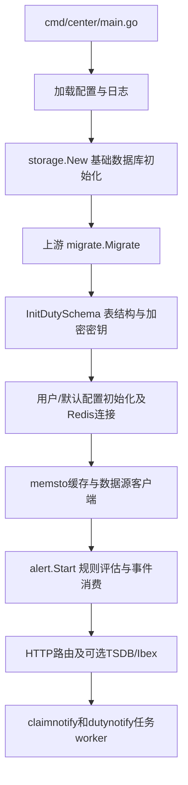
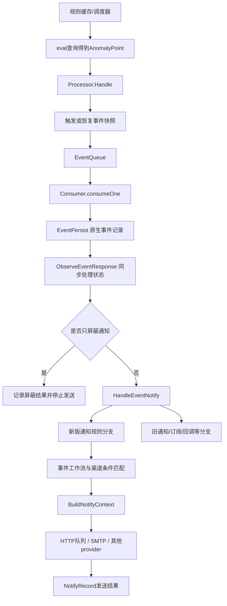

# 夜莺代码导读：从原生告警到值班响应

本文面向继续维护此二次开发版的开发者。以当前仓库实际代码为准，介绍目录职责、调用顺序和关键约束；不将尚未实现的电话升级等需求当作现有能力。

建议阅读顺序：先看第1–3节建立整体认识，再跟第4节走一遍告警；修改值班/认领时看第5–8节。配套前端见 [前端代码导读](https://github.com/Steelki/nightingale-frontend-custom/blob/master/CODE_GUIDE_zh.md)。

## 1. 两个源码仓库与一个运行目录

后端是本仓库，前端是 `Steelki/nightingale-frontend-custom`。本地开发工作区外层的 `go-backend/` 和 `frontend/` 是早期自研系统，不属于这套夜莺代码。本地 `data/previews/nightingale/` 是运行产物/配置/数据库目录，不能当源码目录。

构建入口是 [cmd/center/main.go](cmd/center/main.go)，不是仓库根目录。Go模块路径仍是 `github.com/ccfos/nightingale/v6`，这是上游保留的模块名；产品基线为v9.3.0。

## 2. 后端目录地图

| 目录 | 职责 | 什么时候阅读 |
| --- | --- | --- |
| `cmd/` | 可执行程序入口，包括center、工具命令 | 启动参数、构建目标、SQL生成 |
| `center/` | 服务装配、管理API、认证、后台任务 | 页面API、启动顺序、二次开发worker |
| `conf/`、`etc/` | 配置结构/加载与示例配置 | 监听地址、数据源、数据库、启动参数 |
| `alert/eval/` | 同步规则、创建执行器并查询数据源 | PromQL查询、评估间隔、数据源适配 |
| `alert/process/` | 异常点转事件、持续触发/恢复判断 | 事件周期、原生抑制/重复行为 |
| `alert/queue/` | 告警事件和记录队列 | 评估与通知消费解耦 |
| `alert/dispatch/` | 规则匹配、工作流、模板上下文、接收人和渠道分发 | 通知为何发/不发、值班接收 |
| `alert/sender/` | provider、回调、发送结果记录 | 实际HTTP/SMTP发送和失败 |
| `models/` | 数据模型与业务读写，包含事务逻辑 | 保存校验、认领状态、数据关系 |
| `models/migrate/`、`pkg/ormx/` | 当前结构迁移与基础建库/种子 | 新库初始化、老库升级 |
| `memsto/` | 规则/用户/渠道等内存缓存与通知渠道队列 | 配置同步、普通HTTP通知排队 |
| `storage/` | DB/Redis连接入口 | 连接配置、基础存储初始化 |
| `prom/`、`datasource/`、`dscache/`、`dskit/` | 数据源查询客户端及相关缓存/工具 | 接新数据源、查询故障 |
| `pushgw/`、`tsdb/` | 指标写入转发与可选内置时序库 | 数据采集、内置查询存储 |
| `integrations/` | 官方组件、告警和仪表盘模板资源 | 模板中心内容与部署资源 |
| `aiagent/` | 上游AI对话、工具和技能能力 | AI功能，不是值班通知核心链路 |
| `cron/` | 历史数据/记录等定时清理 | 保留期、后台维护 |
| `front/` | 上游前端资源相关代码 | 注意区别于本项目部署的外部pub资源 |
| `internal/dutyschema/` | 二次开发SQL生成与一致性测试 | 防止模型更新而SQL遗漏 |

`models` 不只是字段定义，保存权限/并发校验/入队事务都在这里。只看router容易漏掉真正的约束。

## 3. 程序怎样启动

[center/center.go](center/center.go) 的 `Initialize` 是装配入口：



收到退出信号时，`main` 调用返回的清理函数。排查“页面没起来”和“通知没发送”时先确定哪个组件初始化失败，不要在业务函数中重复启动全局依赖。

部分上游大表迁移异步运行，不代表HTTP可用时所有上游DDL都已结束。二次开发密钥和表初始化则在启动worker前执行。

## 4. 一条原生告警如何走到通知



依次打开：

1. [alert/eval/alert_rule.go](alert/eval/alert_rule.go)：`Scheduler`同步规则；[eval.go](alert/eval/eval.go)：`AlertRuleWorker.Eval`执行评估。
2. [alert/process/process.go](alert/process/process.go)：`Handle`、`BuildEvent`、`HandleRecover`、`RecoverSingle`、`fireEvent`和`pushEventToQueue`。这里处理规则状态演进，不是用户点击认领的位置。
3. [alert/dispatch/consume.go](alert/dispatch/consume.go)：`consumeOne`持久化后调用`ObserveEventResponse`；[models/alert_his_event.go](models/alert_his_event.go)中`EventPersist`处理原生存储。
4. [alert/dispatch/dispatch.go](alert/dispatch/dispatch.go)：`HandleEventNotify`保留新旧两套分支；`HandleEventWithNotifyRule`处理新版通知规则。
5. `HandleEventPipeline`处理事件加工；`NotifyRuleMatchCheck`检查各渠道条件；`SendNotifyRuleMessage`构建并发送。`SendByNotifyRule`是可替换函数变量，默认指向它，不是另一套独立实现。
6. [memsto/notify_channel_cache.go](memsto/notify_channel_cache.go)：普通HTTP通知在`processNotifyTask`中真正执行；[alert/sender/callback.go](alert/sender/callback.go)的`NotifyRecord`记录结果并接入失败兜底。

不要把“通知规则的原有接收模式”与“后端旧通知链路”混为一谈：前者是新版通知规则里的接收人选择，后者是仍保留的历史发送实现。

### 事件关联ID

原生事件hash由规则、标签、数据源、严重度、查询等信息生成，见`process.Hash`。同一个处理周期使用 `hash + first_trigger_time`，封装在 [models/event_response.go](models/event_response.go) 的 `ResponseEpisode`。

历史事件行ID适合跳详情，但不能当作整个处理周期的唯一键。由于严重度参与原生hash，不同严重度不能直接认为是同一个响应周期；跨严重度合并/补通知仍待实现。

## 5. 团队、业务组和值班组

| 概念 | 职责 |
| --- | --- |
| 业务组 | 上游监控资源、规则等的组织归属 |
| 团队/user_group | 上游用户集合、授权和原有通知接收 |
| 值班组/response_duty_group | 我们新增的人员快照、排班、公共IM、兜底和提醒配置 |

从团队导入值班组是勾选当时人员的快照，不自动跟随团队后续成员变化。通知规则的授权团队用于管理规则权限，不等于当前接收告警的值班组。

[models/duty_group.go](models/duty_group.go)中的`SaveDutyGroup`一次事务完成旧密文合并、轮班转换、合法性校验、加密、版本更新、审计及提醒时钟更新。前端回显的URL/secret为空不代表服务端没配置：留空保留，`clear`才是明确清除。

`ResolveDuty`按指定时刻选择生效计划、计算轮换、应用当天替班、核对账号；它不变更事件负责人。`PrepareDutyRotation`把前端的`rotation_change`变更命令转换成计划版本，保留已生效历史。预览和保存共用这段逻辑，避免两套算法产生不同结果。

## 6. 值班接收怎么接进原生通知

入口在 [models/notify_duty.go](models/notify_duty.go) 的 `VerifyDuty`，保存通知规则时检查模式、组和渠道，清理旧接收参数；不能只靠前端隐藏字段。

发送时 `HandleEventWithNotifyRule` 将规则级 `duty_group_id`放入每个渠道的临时配置，再由 [alert/dispatch/duty.go](alert/dispatch/duty.go) 的 `prepareDutyContext`适配：

- `ResolveDutyRecipient`优先使用显式转交目标，其次恢复事件原认领人，否则按当前排班。
- 公共IM地址来自值班组的加密配置；钉钉@使用当班人手机号。
- 邮件/电话等个人渠道读取用户的联系方式。
- 复制渠道/配置，避免把动态接收人写入共享缓存，影响其他告警。

值班模式需要能访问中心数据库的通知节点；不能把这套能力直接当作已支持无DB远程发送节点。

## 7. 认领、转交和恢复

API入口：[center/router/router_event_response.go](center/router/router_event_response.go)。GET返回状态、日志、两类通知任务；POST调用`ChangeEventResponse`。

| 动作 | 当前行为 |
| --- | --- |
| claim | 已启用账号认领无人负责的未恢复事件 |
| transfer | 当前负责人或管理员转给另一个启用账号 |
| unclaim | 当前负责人或管理员取消，通知当前值班人 |
| comment | 新增处理进展，不改变归属版本 |
| 原生恢复事件 | `ObserveEventResponse`标记恢复；不是人工评论触发恢复 |

`version`是状态并发版本：更新携带旧版本，条件更新不匹配返回冲突。`assignment_version`只跟踪负责人变化，用于判断待发送转交通知是否过时；评论不能导致有效转交通知被取消。

状态、日志和通知入队在一个DB事务内提交，网络发送在事务外由worker执行。发送失败不会撤销已经成功的认领。交班只改变未认领告警的动态接收人，已认领事件留给原负责人，除非手动转交。

认领后停止重复通知的检查在`HandleEventNotify`、`SendNotifyRuleMessage`及HTTP队列真正发送前分别执行，覆盖排队期间发生认领的情况。恢复事件放行，不被“已认领”拦截；已在网络中的请求无法撤回。

## 8. 两类持久通知任务

| 位置 | 持久表 | 内容 |
| --- | --- | --- |
| `center/claimnotify/` | response_claim_notice | 认领后的钉钉群通知 |
| `center/dutynotify/` | response_duty_notice | 转交、取消认领、发送失败兜底、值班提醒 |
| `models/duty_notice.go` | response_duty_reminder_clock | 组提醒下次到期时间 |

这些是二次开发的持久任务，不等于普通HTTP渠道内存队列。普通告警发送也不是全部被改造成持久任务。

任务主要状态是 `pending → sending → sent/failed/skipped`。通过条件更新争抢任务；卡在sending超过两分钟会记为unknown，不自动重发，因为对方可能已经收到。它不是跨网络严格“只送达一次”的承诺。

失败兜底包含原告警和失败接收人、渠道、原因。使用组配置或系统默认，发送前检查目的地仍匹配；兜底失败仅记录，不再次兜底递归。它与“升级联系人逐级通知”不同，后者仍未实现。

值班提醒默认关闭：开启立即到期，之后按配置间隔调度，发送时重新解析当班人。修改实际间隔重算时钟并取消旧pending任务，其他配置保存不重置。停机不补历史；提醒使用组全部公共IM，没有另一份独立渠道选择。

## 9. 数据库与安全边界

完整表清单、初始化与升级说明见 [数据库文档](docker/migratesql/custom/README.md)。二次开发8张表由`DutySchemaModels()`注册；`cmd/duty-schema`和`internal/dutyschema`维护三种数据库SQL及漂移检查。

`config`中的提醒/排班字段是JSON文本，不是每个配置项都有SQL列。敏感地址和任务快照加密保存；`data/duty-notification.key`不能丢失或与其他库混用。接口返回配置不应暴露密文payload或明文密钥。

SQLite/MySQL/PostgreSQL均需考虑，但目前SQLite做过实库验证，其他两种的SQL生成检查不等于实库验证。后续增加查询/字段时遵守 [AGENTS.md](AGENTS.md)。

## 10. 修改需求时从哪里开始

| 需求 | 主要代码 | 验证重点 |
| --- | --- | --- |
| 改排班算法 | duty_group.go、duty_rotation.go；前端RotationEditor | 时区/替班/计划生效/预览保存一致 |
| 改接收模式 | notify_duty.go、dispatch/duty.go；前端ReceiverMode | 新建与编辑同校验、清理旧接收人、各渠道一致 |
| 增加响应动作 | event_response.go、router_event_response.go；前端ResponseProgress | 权限、冲突、原子日志和入队 |
| 改提醒周期 | duty_notice.go、dutynotify/worker.go；前端dutyGroups | 旧默认值、修改间隔、停机、重复抢占 |
| 增加通知渠道 | sender/provider、渠道配置和前端媒介表单 | 业务错误码、超时、失败记录、敏感信息 |
| 改数据库结构 | 模型、启动迁移、SQL生成或版本增量 | 三方言、新装/升级/重复迁移、保留数据 |
| 电话升级/回执 | 需新设计状态及回执处理，不能只改steps表单 | 目前未实现，先明确计时与回执契约 |

## 11. 排查顺序

- 页面保存失败：浏览器请求 → router权限/参数 → 模型校验/版本冲突。前端按钮隐藏不代表后端授权。
- 没产生事件：规则是否分配给引擎 → 数据源查询 → Processor触发/恢复条件。
- 有事件没通知：NotifyMuted/认领 → 新旧链路 → 规则启用/工作流过滤/渠道条件 → 模板 → 接收人/公共地址 → 发送记录。
- 值班提醒没发：组开关 → reminder_clock → duty_notice状态/原因 → 当前排班/账号 → 公共渠道。
- 群收到失败报告：查看原发送失败原因，不能把兜底成功理解为原渠道成功。

日志和任务记录里不要新增完整机器人URL、密码或解密payload。现有关键测试：`internal/dutyschema`、`center/dutynotify`、`center/claimnotify`、`models/duty_rotation_test.go`、`alert/dispatch/duty_test.go`和`alert/sender/provider/duty_email_test.go`。真实供应商送达仍需独立联调。

## 12. 区分上游与我们的改动

上游主流程保留在eval/process/dispatch等目录；我们新增的文件主要带`duty`、`event_response`、`claim_notice`名字，两个通知worker目录及`internal/dutyschema`也是二次开发。不要仅凭目录名认定整个目录都是自研：`center`、`models`、`dispatch`内同时存在原生代码和接入改动。

查看自上游基线以来的精确差异（包含后续文档提交）：

```sh
git diff --stat 98653573c386949985acc9abe6e5957ce6017904 HEAD
git diff 98653573c386949985acc9abe6e5957ce6017904 HEAD -- alert/dispatch/dispatch.go
```

重点接入点是`center.Initialize`注册数据库/worker/路由、`consumeOne`观察事件周期、`BuildNotifyContext`接入值班解析、`NotifyRecord`接入失败兜底，以及发送前的认领检查。修复上游行为前先判断是否会影响这些接入点。

## 外接IM语音设计（未实现）

参见 [IM语音与升级设计](VOICE_INTEGRATION_DESIGN_zh.md)，涵盖平台能力边界、企业应用授权、身份映射、回执状态、升级并发与多数据库验收要求。
