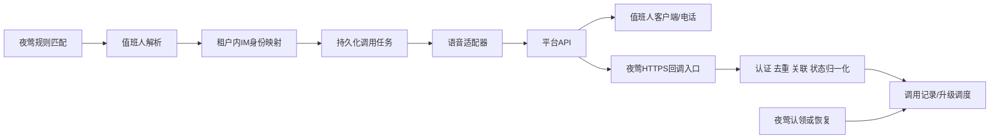

# 夜莺外接IM语音与升级设计

状态：**Teams首版适配已编码并通过本地模拟验证；未进行真实租户联调。完整多级升级仍为设计。** 资料核查日期：2026-11-13。

本文件承接当前值班/认领功能，设计外部夜莺系统通过企业应用调用IM语音或加急能力。平台能力与实现建议分别列明，不能因存在本设计就将语音、电话回执或多级升级标记为完成。

## 0. Teams首版实际实现（2026-11-13）

- 独立 `teams_voice` 媒介，保留现有 `teams` 群卡片。配置/账号映射见 [models/teams_voice.go](models/teams_voice.go)；映射源为夜莺账号邮箱，目标为本媒介租户内Entra用户Object ID。凭据引用必须为 `N9E_TEAMS_` 前缀环境变量，密钥不在Web表单、媒介JSON或日志中保存。
- [TeamsVoiceProvider](alert/sender/provider/teams_voice_provider.go)只持久入队。`response_teams_voice_call`记录周期、规则/组/媒介、标题快照、受理、接通、播放、结束与原因；事件与配置快照使用既有值班通知密钥加密。任务去重键含规则/媒介/组/事件周期/触发时间/接收邮箱，不是跨事件聚合。
- [worker](center/teamsvoice/worker.go)发送前复查认领、恢复、媒介/规则启用和当班人；未认领任务跟随当班人。Azure Speech REST将纯文本标题合成16kHz/16bit单声道WAV，先保存音频再调用Graph。标题最多160字符，超长截短；SSML内容转义。缺少配置/合成失败明确记录失败，不偷换为固定提示音。
- 接通回调后播放一次；完成后请求结束，超过创建时间120秒也请求结束。任务15分钟过期，删除临时音频。Graph/TTS每次请求20秒超时，无盲目拨号重试；结果未知不当作确认失败。回调丢失时最终状态未知，不假造未接听。
- [回调认证](center/teamsvoice/auth.go)使用微软固定OIDC入口、RSA签名/有效期/应用audience/允许issuer/原始tid租户校验（兼容.NET映射后的长URI声明名），不信任JWT的jku。重复、提前及乱序回调不会抹掉接通/结束事实。播放明确失败、调用明确失败或平台结束错误码进入现有失败兜底，同一呼叫只入队一次；这不执行上级升级。
- [路由](center/router/router_teams_voice.go)：`POST /api/n9e/teams-voice/callback/:id`要求微软Bearer JWT；`GET /api/n9e/teams-voice/audio/:id?token=...`使用15分钟短期访问凭证。音频存于中心节点 `data/teams-voice`，不能把该目录静态公开；反向代理须按请求路由至可见该目录的实例且不记录token。夜莺访问日志已跳过语音路径。
- 处理进展API `GET /api/n9e/event-response`增加 `teams_voice_calls`（最多30条）；需原有用户认证。敏感快照、音频token及去重键不输出；详情页独立显示通话状态，接听不修改认领。
- 前端通知媒介可新建、编辑账号映射；通知规则无需选择消息模板。仅用于未认领故障提醒，恢复不发语音；已认领转交不重新拨号。普通“测试发送”不适用于持久呼叫，明确拒绝并提示使用专用测试告警，避免误显示发送成功。
- 三库初始化与新 `002-teams-voice-*.sql`同步，已发布001未更改。SQLite初始化/升级/重复迁移/保数据与模拟链路已验证；MySQL/PostgreSQL仅方言/生成一致性，未实库验收。

运行前在服务端设置表单引用的Teams应用密钥和Azure Speech资源密钥，配置Calling Bot、应用权限、同租户测试账号及可达HTTPS站点。Azure Speech是独立资源，Teams权限不包含TTS服务。配置完成不代表租户已联调。临时停发可设置 `N9E_DISABLE_TEAMS_VOICE=1`；隔离测试通用开关 `N9E_DISABLE_DUTY_DELIVERY=1`也禁用此worker。

首版使用本地音频目录，尚未验证多中心共享存储/路由；没有PSTN手机外呼、动态TTS供应商切换、按键认领或实时语音对话。5分钟未认领/多级升级执行器、跨严重度周期关联继续待办。以下章节保留后续完整升级设计，不能据此宣称已交付。

## 1. 目标与边界

- 通知规则决定哪些严重度走电话/语音，值班组统一提供接收对象。
- 夜莺后台主动发起通知，用户在目标客户端或电话端接收。
- 保存可追溯的调用、回执及升级记录；只有平台提供的事实才映射成对应通话状态。
- 保持“5分钟未认领升级”和“明确呼叫失败可升级”的方向；认领/恢复停止后续升级，全员模式不参与自研升级。
- 本设计不将群Webhook、应用内加急提示、会议邀请、PSTN手机电话统称为应用内语音。
- 跨严重度事件关联仍是另一项待办，本设计沿用当前 `hash + first_trigger_time` 周期，不自行合并不同hash。

### Teams首版播报约定（2026-11-13 用户确认）

用户已选择开发Teams应用内语音。语音用于提醒查看群内告警，接通后动态播报告警标题；不采用仅播放固定提示音的首版方案，也不朗读完整告警正文。建议话术为“告警提醒：{告警标题}。请查看群消息并及时认领。”标题须与本次告警消息对应，生成调用任务时保存快照，避免后续规则改名导致播报与通知不一致。

Teams Graph的 `playPrompt` 接收音频资源，不能直接传告警标题并期待平台合成语音。因此实现链路必须包含“标题文本 → TTS合成 → 有效期内可获取的HTTPS音频 → 接通后播放”。TTS供应商、凭据及音频托管是独立配置；Teams呼叫权限不自动包含语音合成能力。未配置TTS时明确提示无法播报，不静默替换为固定音频。标题按纯文本处理，去除标记/控制字符，限制长度；使用SSML时转义用户内容，不能将标题当作SSML执行。

群消息与语音共用告警事件关联，群消息继续负责完整信息和处理入口。是否需要强制等待群消息发送成功再呼叫尚未作为硬依赖实现；消息接口受理不能宣称群内人员已收到或阅读。消息失败应保留原有失败兜底，避免把消息失败隐藏为语音成功。

不要求用户完整听完才算接通：接通、播放完成、通话结束和夜莺认领分别记录。接通后提前挂断保留已接通事实，不据此推断已经处理，也不简单当成无人接听而立即升级；未认领超时逻辑仍以夜莺认领状态为准。真实接通效果、音频兼容性和回调仍需租户联调。

该产品约定已在首版Teams呼叫/TTS/回调中实现并模拟验证；真实通话及升级执行仍未验收。

## 2. 已核实的平台能力

| 平台 | 已核实 | 尚不能承诺 |
| --- | --- | --- |
| Teams | Graph创建机器人到Teams用户的P2P VoIP呼叫；call状态回调；service-hosted media播放音频提示 | 租户已获授权、端到端可用、播放完成等于用户听完、PSTN免额外配置 |
| 飞书 | 应用机器人发送消息后可调用电话加急；存在应用内加急和会议邀请API | 通用机器人主动一对一应用内语音播报；完整拒接/接听/播报最终回执 |
| 钉钉 | 本轮未取得可可靠核查的官方接口正文 | 不能仅凭客户端通话/DING功能推断有对外呼叫API |

Teams语音与现有Teams Workflows卡片必须是不同媒介。飞书电话加急也必须与普通应用消息、urgent_app提示区分。

飞书urgent_phone只能加急当前应用机器人自己发出的消息，受机器人/会话权限、用户可见性与企业加急额度限制；部分会话情形仅应用内提醒。API响应中的invalid_user_id_list及错误码反映受理结果，不是完整电话账单/回执。

## 3. 外部系统接入拓扑

初版建议在后端增加独立语音模块并复用provider注册机制，无需把夜莺客户端嵌入IM。若将来需要自己处理实时媒体，再评估独立媒体服务；这不是初版前提。

本地仅监听127.0.0.1的8772不能被平台直接回调。真实联调前必须配置外部可达HTTPS域名/测试网关、证书及正确站点URL。业务管理接口的权限不能因开放回调入口而一并放开。

## 4. 平台侧配置

### Teams路线

1. 注册Entra应用及支持呼叫的Teams bot，按官方要求配置应用清单、租户策略及可见范围。
2. 为目标呼叫场景申请Graph应用权限及管理员同意；P2P VoIP官方示例使用 `Calls.Initiate.All`。
3. 配置HTTPS回调及凭据管理。凭据只供服务端使用，禁止发给浏览器或写入日志。
4. 使用service-hosted media发起呼叫，在接通后播放预先准备的音频资源。
5. 音频生成/TTS、音频格式、托管和有效期另行落实；`playPrompt`本身不是任意文本转语音API。

application-hosted media涉及额外媒体权限、.NET实时媒体库与Windows托管要求；暂不把该方案引入Go主服务。平台额度、租户策略、授权及客户端接收效果须真实验证，不作费用承诺。

### 飞书路线

1. 创建企业应用，启用机器人及所需消息/加急权限，确认可见用户范围与企业额度。
2. 夜莺用该应用发出告警消息，保留message_id。
3. 同一应用调用urgent_phone，对指定用户加急。
4. 当前只把请求成功标记为受理。最终通话回执如无官方可用接口，保持未确认，不制造接听/失败事件。

## 5. 夜莺中的配置归属

| 配置 | 归属与建议 |
| --- | --- |
| tenant/app ID、凭据引用、平台、回调配置 | 通知媒介；不要重复保存在每个值班组 |
| 夜莺用户到平台用户ID的映射 | 用户联系方式的专用映射，包含平台、租户、必要应用作用域 |
| 班表、升级联系人、公共群与兜底 | 现有值班组 |
| 哪些严重度用语音、播报模板 | 通知规则的渠道配置 |
| 认领人及认领/恢复状态 | 现有response_event |
| 本次调用及平台回执 | 新增持久调用记录，不能混入用户联系方式 |

不按姓名模糊匹配平台账号；同名、不同租户或不同应用的open_id不能互换。保存时验证映射格式/归属，发送时复查账号启用状态。映射缺失应明确记录失败和走既定兜底，不能偷偷回退全员。

渠道应显式声明能力，例如“应用内语音”“PSTN电话”“仅消息加急”“是否有最终回执”。不能仅因接收字段为phone，就把短信当电话升级渠道。

## 6. 建议的调用与回执模型

以下为后续完整升级的逻辑字段；当前仅首版Teams呼叫表已落地，见第0节：

| 对象 | 关键内容 |
| --- | --- |
| 升级流程 | 周期ID、组ID、规则/媒介及策略版本快照、当前级别、next_at、状态、并发版本 |
| 呼叫尝试 | attempt_id、流程/级别、接收用户、平台及租户、平台call_id/message_id、提交状态、通话事实与时间 |
| 回执事件 | 平台事件ID或稳定摘要、所属调用、平台原状态/原因、认证结果、发生/接收时间、处理结果 |

规则、组成员或配置变化不应静默改写已经生成的历史记录。正在执行的任务用版本/策略快照控制，发送前再核对认领与恢复状态。

内部attempt ID与外部call ID分开：一个告警可能有多个级别、多人及多次调用。外部ID至少按平台/租户/媒介作用域关联，不能只按字符串碰巧相同就认为是同一通话。

### 状态不压成一个“成功”

- 提交状态：待发送、发送中、已受理、明确拒绝、结果未知。
- 通话事实：振铃、已接通、播放完成、结束及原因；没有回执则留空/未知。
- 告警处理：未认领、已认领、已恢复，继续来自夜莺处理状态。

接口返回201/200只说明API调用阶段；消息已读不证明电话接通；接通不证明播报完成；播报完成不自动代表夜莺认领。调用结束需结合之前状态及原因，不能将所有terminated判定为失败。

## 7. 发送、回调和并发处理

建议流程：

1. 匹配通知规则且有可用语音渠道时，先持久化流程/调用任务，再由worker发起网络请求。
2. 使用数据库唯一约束与条件更新争抢任务；不要依赖进程内锁保证多实例不重发。
3. API响应保存平台ID；若请求超时且平台可能已受理，记为未知，不能立即无限重拨。按平台支持情况用幂等键或查询接口对账。
4. 回调采用平台规定的认证方式，验证来源及租户/应用/调用关联。具体校验方法随选定平台落实，不虚构一个各平台通用的签名协议。
5. 验证后的回执先持久化，再返回响应并异步处理；重复回执不重复升级或再次播放音频。
6. 平台回调可能早于发起接口返回，须暂存待关联或使用平台支持的client context关联，不丢弃已验证事件。
7. 乱序回执保留审计但不回退状态；终止后迟到的ringing不能把通话“复活”。
8. 已认领/恢复后仍可接收迟到回执用于记录，但不再启动下一轮升级。

回调路由拟归入独立语音路由模块；实际路径尚未注册。公共回调不能套浏览器登录，也不能无认证写入任务状态。日志仅记录脱敏关联信息，不记录完整token、带凭据URL或原始敏感payload。

## 8. 升级策略与待定参数

已确认方向：仅配置电话/语音的告警级别参与；未认领超时可升级，明确呼叫失败也可升级；全员模式不升级；认领或恢复停止后续升级；非语音渠道失败走兜底。

建议实现中将“认领超时”与“最终回执失败”设为两种触发原因，共用同一个阶段状态及去重键，避免两种原因同时触发两次上报。

| 事项 | 当前状态/建议，需实施前定案 |
| --- | --- |
| 首级未认领等待 | 目标5分钟；建议从首个有效语音任务持久化时间起计，重复告警不重置 |
| 各级等待 | 复用DutyStep.wait_minutes；需明确首级与固定5分钟设置的关系 |
| 同级多人部分失败 | 建议其他人仍在振铃/处理中时不因一个人失败连续穿透所有级别；具体聚合条件待定 |
| 供应商结果未知 | 不冒充明确失败，仍按未认领计时；是否查询对账由平台能力决定 |
| 取消认领 | 按已接受方向重新通知当班人，并为新的未认领阶段计时；旧阶段任务须作废 |
| 已认领事件交班 | 保持原负责人，仅手动转交改变归属 |
| 等待平台回执期间认领/恢复 | 取消尚未执行的升级，不能承诺撤回已经发到平台的呼叫 |
| 多条通知规则指向同组 | 需要明确流程唯一键及去重范围，防止多条路径同时电话轰炸 |

上述建议尚不是已实现行为。首个适配器选定后，应把待定项落实为接口契约和测试，再实现升级执行器。

## 9. 具体代码接入位置

| 当前文件 | 当前实现 | 后续扩展点 |
| --- | --- | --- |
| [provider/provider.go](alert/sender/provider/provider.go) | 单次Notify调用/返回值 | 明确受理与最终回执边界，不把Err=nil当接听 |
| [teams_provider.go](alert/sender/provider/teams_provider.go) | Workflows卡片消息 | 新建独立Calling Bot媒介，不改变旧卡片语义 |
| [feishuapp_provider.go](alert/sender/provider/feishuapp_provider.go) | 飞书应用消息 | 电话加急适配需保留message_id并追加加急调用 |
| [models/notify_duty.go](models/notify_duty.go) | email/phone及公共群适配检查 | 增加IM身份映射与语音能力校验 |
| [dispatch/duty.go](alert/dispatch/duty.go) | 当前排班/显式负责人解析 | 复用人员解析，再映射平台账号 |
| [sender/callback.go](alert/sender/callback.go) | 原通知调用结果和失败兜底 | 独立供应商回执入口，避免混淆发送日志 |
| [models/duty_group.go](models/duty_group.go) | 升级联系人配置 | 配置校验与策略快照；现有Steps未被升级worker消费 |
| [center/dutynotify/worker.go](center/dutynotify/worker.go) | 响应/提醒持久任务 | 参考抢占和恢复思路，不能直接当完整呼叫状态机 |
| 前端notificationChannels | 现有消息/电话媒介配置 | 新增平台授权信息、接收映射及能力说明 |
| 前端ResponseProgress | 处理日志与通知状态 | 区分调用受理、通话回执、升级原因和夜莺认领 |

## 10. 数据库与升级要求

新增模型必须同步SQLite、MySQL、PostgreSQL初始化SQL、启动迁移及新版本增量SQL；已发布001不重写。可索引幂等键建议使用固定长度摘要，避免MySQL长文本索引限制；不要依赖单一数据库的JSON查询、布尔或DDL事务行为。

新增回执/呼叫数据的保留期、索引和清理需考虑持续写入量。凭据引用与加密密钥的备份/恢复文档同步维护。首版已新增response_teams_voice_call及认证回调API；完整升级流程表仍待实现。

## 11. 验收与推进顺序

1. 确定平台和企业应用权限：优先验证Teams P2P应用内语音，或将飞书定义为电话加急渠道；两者不能混称同一能力。
2. 实现通用流程/调用/回执模型、身份映射和模拟适配器，先验证去重、乱序、并发、未知结果及认领/恢复停止。
3. 实现一个真实平台适配，使用明确测试用户和可达HTTPS回调进行小范围联调。
4. 接入多级等待、明确失败触发及兜底，覆盖同级多人、配置变更、重启和重复触发。
5. 完成三种数据库的新装、升级、重复迁移与保数据实库验证，再宣称对应数据库已验收。

真实验证还应覆盖无权限、账号映射错误、token过期、回调伪造、重复回调、回调先于响应、客户端离线/拒接、音频不可访问、平台额度不足及限流。不能仅靠模拟或API成功标记端到端送达完成。

首版适配已包含实际后端/前端及SQL变更；本地验证不创建租户应用、不申请权限、不发送真实电话。

## 12. 官方参考资料

- [Azure Speech REST文字转语音](https://learn.microsoft.com/en-us/azure/ai-services/speech-service/rest-text-to-speech)
- [微软回调认证样例](https://github.com/microsoftgraph/microsoft-graph-comms-samples/blob/master/Samples/Common/Sample.Common.V1/Authentication/AuthenticationProvider.cs)

- [Graph创建呼叫](https://learn.microsoft.com/en-us/graph/api/application-post-calls?view=graph-rest-1.0)
- [Graph call资源与状态](https://learn.microsoft.com/en-us/graph/resources/call?view=graph-rest-1.0)
- [Graph播放提示音](https://learn.microsoft.com/en-us/graph/api/call-playprompt?view=graph-rest-1.0)
- [Teams呼叫机器人及媒体托管](https://learn.microsoft.com/en-us/microsoftteams/platform/bots/calls-and-meetings/calls-meetings-bots-overview)
- [飞书电话加急](https://open.feishu.cn/document/server-docs/im-v1/message/urgent_phone)
- [飞书官方SDK接口说明](https://github.com/larksuite/oapi-sdk-go/blob/v3_main/service/im/v1/resource.go)
- [飞书官方SDK响应模型](https://github.com/larksuite/oapi-sdk-go/blob/v3_main/service/im/v1/model.go)
- [飞书会议API](https://github.com/larksuite/oapi-sdk-go/blob/v3_main/service/vc/v1/resource.go)

官方资料会变化；实施时再次核实具体权限、回调认证和租户开放范围。本文件不提供未经核实的供应商回执字段或费用承诺。
